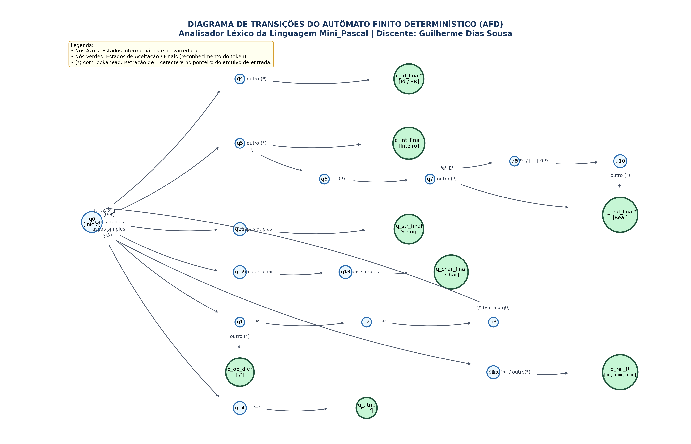

# Analisador Léxico - Mini_Pascal

[](https://dotnet.microsoft.com/)
[](https://learn.microsoft.com/dotnet/desktop/winforms/)
[](http://www.uesb.br/)

Projeto prático desenvolvido para a disciplina de **Compiladores (2026.2)** da **Universidade Estadual do Sudoeste da Bahia (UESB)**.
- **Docente:** Prof. José Carlos Martins Oliveira
- **Discente:** Guilherme Dias Sousa
- **Curso:** Ciência da Computação

---

## 📌 Sobre o Projeto

O objetivo deste projeto é a implementação de um **Analisador Léxico completo para a linguagem Mini_Pascal**, primeira fase do compilador. 

O compilador lê o código-fonte em formato texto (`.txt`), desconsidera caracteres de formatação (espaços, tabulações e quebras de linha) e comentários de bloco (`/* ... */`), agrupando os caracteres válidos em lexemas e classificando-os em pares `<lexema, token>`.

O analisador foi construído estritamente sobre a teoria de um **Autômato Finito Determinístico (AFD)**, garantindo tempo de resposta linear $O(n)$ e tratamento robusto de erros léxicos por modo pânico (descarte local).

---

## ⚙️ Tecnologias Utilizadas

- **Linguagem:** C# (.NET 10.0)
- **Interface Gráfica:** Windows Forms (GUI interativa e amigável)
- **Modo CLI:** Suporte a execução em linha de comando (batch)
- **Estruturas de Dados:** `Dictionary<string, TokenType>` com busca em tempo constante $O(1)$ para a Tabela de Símbolos e Palavras Reservadas

---

## 🧠 Autômato Finito Determinístico (AFD)

O autômato é formalizado pela 5-tupla $M = (Q, \Sigma, \delta, q_0, F)$:
- **$Q$**: Conjunto finito de estados de processamento.
- **$\Sigma$**: Alfabeto da linguagem (letras, dígitos, operadores e pontuação).
- **$\delta$**: Função de transição determinística.
- **$q_0$**: Estado neutro inicial.
- **$F$**: Conjunto de estados de aceitação (com retração/lookahead quando sinalizados com `*`).



---

## 📂 Estrutura do Repositório

```text
├── Entrega_Trabalho_1/          # Pasta com todos os artefatos de entrega
│   ├── CodigoFonte/             # Código-fonte C# (.NET 10) limpo e comentado
│   ├── Documentacao/            # Relatórios e especificações em PDF e TXT
│   ├── Executavel/              # Binário pronto para execução direta no Windows
│   ├── Testes/                  # 5 arquivos de entrada e 5 de saída
│   └── README.txt               # Instruções de entrega
├── Material_Apresentacao/       # Apoio para defesa oral
│   ├── guia_apresentacao.pdf    # Roteiro cronometrado e perguntas prontas
│   ├── guia_apresentacao.txt    # Versão em texto puro
│   └── diagrama_afd.png         # Diagrama em alta resolução para projeção
├── MiniPascalLexer/             # Projeto do Analisador Léxico
│   ├── Lexer/                   # Motor AFD, Tokens e Tabela de Símbolos
│   ├── UI/                      # Janela principal Windows Forms
│   └── Program.cs               # Entry-point híbrido (GUI ou CLI)
├── executavel/                  # Executável Release (MiniPascalLexer.exe)
├── testes/                      # Casos de teste da especificação
└── Trabalho_Compiladores_I_Guilherme_Dias_Sousa.rar  # Arquivo compactado para envio
```

---

## 🚀 Como Executar

### 1. Interface Gráfica Windows Forms (Recomendado)
Execute com duplo clique o executável disponível em `executavel/MiniPascalLexer.exe`:
- **Editor de Código:** Digite ou cole o código Mini_Pascal.
- **Exemplos de Teste:** Menu superior para carregar instantaneamente qualquer um dos 5 testes pré-definidos.
- **Executar Análise Léxica:** Processa e lista todos os tokens na tabela com linha e coluna.
- **Painel de Diagnósticos:** Relatório de erros léxicos encontrados com linha e coluna.
- **Salvar Tokens (.txt):** Exporta o arquivo no formato solicitado `<lexema, token>`.

### 2. Modo Linha de Comando (CLI / Batch)
```powershell
cd MiniPascalLexer
dotnet run -- ..\testes\teste1_exemplo1.txt ..\testes\minha_saida.txt
```

---

## 🧪 Casos de Teste Validados

1. **`teste1_exemplo1.txt`**: Exemplo 1 do PDF oficial (`var`, `const pi := 3.1416`, `if/else`, `read`, `write`) $\to$ **50 tokens reconhecidos | 0 erros**.
2. **`teste2_exemplo2.txt`**: Programa Piloto com laço `for cont=1 to total do`, cálculo de médias, strings e reais $\to$ **108 tokens reconhecidos | 0 erros**.
3. **`teste3_estruturas.txt`**: Laços `while-do`, `repeat-until`, char delimitado por aspas simples e operadores lógicos $\to$ **72 tokens reconhecidos | 0 erros**.
4. **`teste4_operadores.txt`**: Operadores relacionais, aritméticos e notação científica (`24.40e-04`) $\to$ **69 tokens reconhecidos | 0 erros**.
5. **`teste5_erros.txt`**: Recuperação de erro léxico com símbolos inválidos (`@`, `$`), strings abertas e números reais malformados $\to$ **36 tokens | 5 erros reportados com precisão**.

---

## 📄 Licença

Este projeto é de cunho acadêmico para avaliação na disciplina de Compiladores da Universidade Estadual do Sudoeste da Bahia (UESB).
